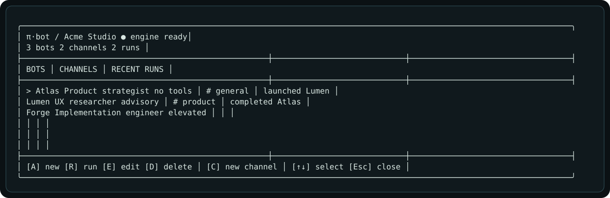
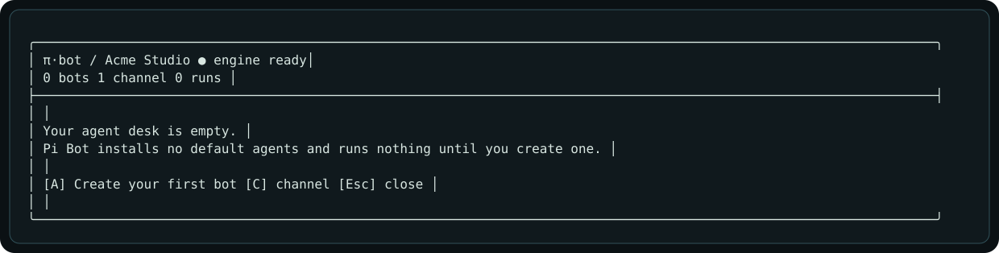
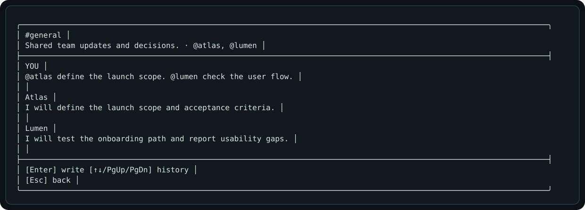

# Pi Bot

**Build your own AI agent desk inside [Pi](https://pi.dev).**

Pi Bot is an open-source Pi package for creating custom agents with their own identity, role, personality, operating instructions, tools, model policy, channels, activation settings, and bounded team-management authority. It ships with **no default agents** and runs nothing until you create one.



## Why Pi Bot?

Agent frameworks often start with someone else's team. Pi Bot starts empty.

- Create specialists that match your work.
- Keep personality separate from authority.
- Review the exact tools before an agent can use them.
- Run agents through the supported `pi-subagents` runtime.
- Keep configuration local and outside your repository.
- Use an accessible, keyboard-first Pi TUI.

## Requirements

- Pi 0.84.3 or newer.
- Node.js 22.19 or newer. Node.js 24 is recommended for development.
- [`pi-subagents`](https://github.com/nicobailon/pi-subagents) 0.57.0.

## Install

Install the execution engine and Pi Bot:

```bash
pi install npm:pi-subagents@0.57.0
pi install git:github.com/Charlisim/pi-bot@v0.3.1
```

Restart Pi, or run:

```text
/reload
```

Then open Pi Bot:

```text
/pi-bot
```

> Pi packages run as trusted local code with your user permissions. Review packages before installing them.

## First-run onboarding

Pi Bot creates only an empty workspace during onboarding. It does not install agents, prompts, or background jobs.

```text
/pi-bot
```

The guided flow asks for:

1. Workspace name.
2. Bot identity and role.
3. Personality, principles, and boundaries.
4. Operating instructions.
5. Explicit tool authority.
6. A provider from Pi's active registry.
7. An exact model and a supported reasoning effort.
8. Channel and manual activation settings.

You review the key execution settings before the profile is saved. First select a provider. Then select a model from pages of at most ten entries. The picker follows Pi's active or session-scoped model list and opens on the saved or current model. The effort picker shows only levels supported by that model.



## Commands

```text
/pi-bot                          Open the dashboard
/pi-bot status                   Show workspace totals
/pi-bot list                     List bot IDs and roles
/pi-bot new                      Create a bot
/pi-bot edit <bot-id>            Edit a bot
/pi-bot delete <bot-id>          Delete a bot definition
/pi-bot run <bot-id> [task]      Launch a bot
/pi-bot inspect <run-id>         Open saved and runtime run details
/pi-bot channel                  Create a channel
```

Press `Ctrl+Shift+B` to open the dashboard. Use `←` and `→` to move between the bot, channel, and run columns. Use `↑` and `↓` to select a row. Press `Enter` to open the selected bot, channel, or run. Press `Esc` to return to the dashboard.

## Conversations

A bot has one direct conversation per project. Ordinary bots continue their prior runtime session when pi-subagents can resume it. Managers start a fresh run with saved conversation history so each run receives a new team-control token.

A channel keeps one shared local conversation. Press `Enter` inside a bot or channel conversation to open Pi's multiline editor.

- Mention assigned bots by ID, such as `@atlas`, to send only to them.
- When a channel message has no mentions, every assigned bot receives it.
- Each bot is instructed to answer only the part relevant to its role.
- Use `↑`, `↓`, `PgUp`, and `PgDn` to read older messages.
- Use `Esc` or `q` to return to the dashboard.

Conversation history is not pruned automatically. The local state safety limits are 10,000 messages and 16 MiB per project.



The model-facing `pi_bot` tool can list bots. It can launch a bot only after an interactive human confirmation.

## Managed teams

A bot can receive explicit team-management authority. Managers can inspect their subtree, search the active model catalog, hire descendants, create groups, archive descendants, and delegate tasks. Descendants can never widen inherited provider, tool, effort, team-size, or depth caps. Team changes run through an authenticated parent-owned control bridge and leave bounded audit receipts. Archived bots keep history and can be restored with `U` from the dashboard.

## Authority profiles

Pi Bot never derives authority from a personality prompt.

| Profile | Tools | Intended use |
| --- | --- | --- |
| No tools | None | Advice, writing, planning |
| Advisory | `read`, `grep`, `find`, `ls` | Repository analysis |
| Builder | Advisory tools plus `bash`, `edit`, `write` | Explicit implementation work |
| Custom | Exact user-entered built-in names | A narrower built-in tool set |

Builder and custom selections require an additional confirmation. Pi Bot rejects unknown extension tools and recursive orchestration tools. Agents cannot spawn subagents or grant themselves new capabilities.

## How execution works

Pi Bot publishes each saved profile in pi-subagents' documented user-agent format. A run uses the documented in-process `subagents:rpc:v1` protocol.

```text
Pi Bot profile
    │
    ├─ explicit system prompt
    ├─ explicit tools
    ├─ model policy
    └─ trusted project-context choice
             │
             ▼
       pi-subagents async run
```

Runs are asynchronous. Direct and channel conversations use the public resume RPC to continue available bot sessions. Pi's FleetView and subagent commands remain the source of truth for detailed execution status and artifacts.

## Local data

Pi Bot stores one schema-versioned workspace per project under:

```text
~/.pi/agent/pi-bot/projects/<project-hash>/workspace.json
```

Set `PI_CODING_AGENT_DIR` to move the Pi agent directory.

State files use restrictive permissions and atomic replacement. Profiles contain the personality and instructions you enter. Run receipts contain each task verbatim. Conversations contain human messages and final bot responses. Do not put credentials or secrets in profiles, tasks, or conversations. Pi Bot does not store raw subagent transcripts, tool output, or environment values.

Generated runtime profiles live under `~/.pi/agent/agents/pi-bot/<project-hash>/`. Their runtime names include a project hash, so bots from different projects do not collide.

To remove local Pi Bot state, exit Pi and delete:

```bash
rm -rf ~/.pi/agent/pi-bot
```

## Security model

- Pi Bot is policy enforcement, not an operating-system sandbox.
- Project files, issue text, messages, and tool output are untrusted data.
- A prompt cannot expand an agent's tools.
- Recursive subagent tools are denied.
- Project instructions are shared only after explicit confirmation.
- Elevated tools require confirmation before each run.
- A model's claim is not execution evidence. Use tool and provider receipts.
- Model prompts can be sent to the selected provider and can incur provider costs.

See [SECURITY.md](SECURITY.md) and [the architecture notes](docs/architecture.md).

## Current scope

Version 0.2 is local-first:

- Custom agent creation, editing, deletion, and execution.
- Personality and policy compilation.
- Persistent direct bot conversations with continued context.
- Persistent channel conversations with mention routing or assigned-bot fanout.
- Run receipts and completion state.
- Responsive Pi-native dashboard.

Slack adapters, webhooks, schedules, Orca/Herdr bridges, and shared team servers remain outside the current scope. See [the roadmap](docs/roadmap.md).

## Development

```bash
git clone https://github.com/Charlisim/pi-bot.git
cd pi-bot
pnpm install
pnpm check
pnpm evidence
pnpm pack --dry-run
```

Tests do not require API keys or a paid model.

See [CONTRIBUTING.md](CONTRIBUTING.md).

## License

MIT © Carlos Simon
